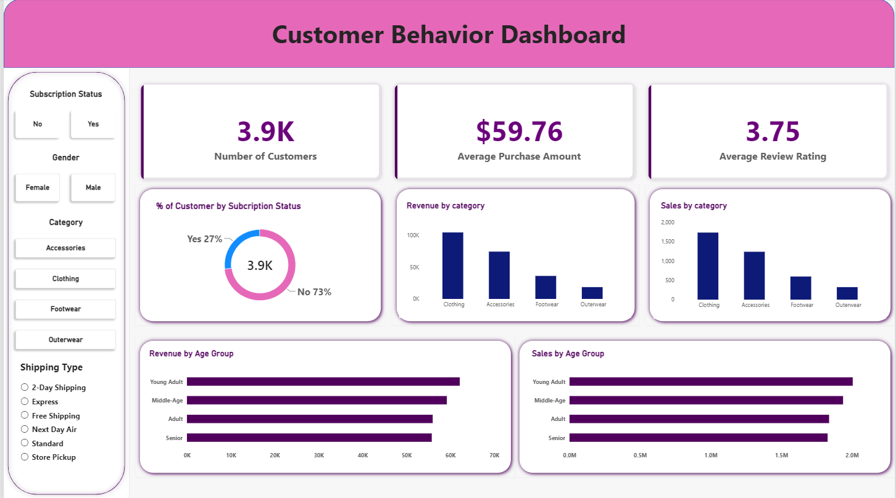

# Customer Shopping Behavior Analysis

## 1. Project Overview

This project focuses on analysing customer shopping behaviour using transactional data from 3,900 purchase records across different product categories.

The objective is to understand customer purchasing patterns, spending behaviour, product preferences, discount usage, and subscription trends.

The project follows an end-to-end data analytics workflow using Python, PostgreSQL, and Power BI, transforming raw data into meaningful business insights and recommendations.

## 2. Dataset

**Dataset:** `customer_shopping_behavior.csv`

**Dataset Summary:**
- Total Records: 3,900
- Total Columns: 18
- Missing Values: 37 in the Review Rating column

**Key Features:**
- Customer demographics: Age, Gender, Location, Subscription Status.
- Purchase information: Item Purchased, Category, Purchase Amount, Season, Size, Color.
- Shopping behaviour: Discount Applied, Promo Code Used, Previous Purchases, Frequency of Purchases, Review Rating, Shipping Type.

## 3. Tools & Technologies

| Tool | Purpose |
|---|---|
| Python | Data analysis and processing |
| Pandas | Data manipulation and cleaning |
| PostgreSQL | Database management and SQL analysis |
| SQLAlchemy | Python-PostgreSQL connection |
| pgAdmin | SQL query execution |
| Power BI | Interactive dashboard creation |
| Gamma | Project presentation |

## 4. Project Workflow

### Step 1: Data Loading & Exploration (Python)

- Imported the dataset using Pandas.
- Examined the dataset structure using `df.info()`.
- Generated descriptive statistics using `df.describe()`.
- Identified missing values and explored data distributions.

### Step 2: Data Cleaning & Transformation

- Identified 37 missing values in the Review Rating column.
- Imputed missing ratings using the median rating of each product category.
- Renamed columns using snake_case for consistency.
- Created an `age_group` column by categorising customer ages.
- Created a `purchase_frequency_days` column to convert purchase frequencies into numerical day intervals.
- Checked redundancy between `discount_applied` and `promo_code_used` and dropped the redundant `promo_code_used` column.

### Step 3: Database Integration (PostgreSQL)

- Connected Python to PostgreSQL using SQLAlchemy.
- Loaded the cleaned Pandas DataFrame into the `customer_behavior` database.
- Stored the cleaned dataset in the `customer` table.
- Verified the data before performing SQL analysis.

### Step 4: SQL Business Analysis

Performed 10 SQL analyses to answer business-related questions:

1. Revenue by Gender
2. High-Spending Customers Using Discounts
3. Top 5 Products by Average Rating
4. Standard vs. Express Shipping Comparison
5. Subscribers vs. Non-Subscribers
6. Products with the Highest Discount Rates
7. Customer Segmentation (New, Returning, Loyal)
8. Top 3 Most Purchased Products per Category
9. Repeat Buyers and Subscription Status
10. Revenue Contribution by Age Group

SQL concepts used included:
- SELECT and WHERE
- GROUP BY and ORDER BY
- Aggregate Functions (COUNT, SUM, AVG)
- CASE Statements
- Subqueries
- Common Table Expressions (CTEs)
- Window Functions

### Step 5: Power BI Dashboard

Developed an interactive dashboard to visualise customer shopping behaviour and key business metrics.

**Dashboard KPIs:**
- Number of Customers: 3.9K
- Average Purchase Amount: $59.76
- Average Review Rating: 3.75

**Visualisations:**
- Customer distribution by subscription status.
- Revenue by product category.
- Sales by product category.
- Revenue by age group.
- Sales by age group.

**Interactive Filters:**
- Subscription Status
- Gender
- Product Category
- Shipping Type

## 5. Key Results & Findings

The following findings were obtained from PostgreSQL queries and Power BI analysis.

### 1. Revenue by Gender

- Male customers generated total revenue of **$157,890**.
- Female customers generated total revenue of **$75,191**.

Male customers contributed a higher share of the recorded revenue.

### 2. High-Spending Discount Users

Identified **839 purchase records** where customers used discounts while spending at or above the overall average purchase amount.

### 3. Top 5 Products by Average Rating

| Product | Average Rating |
|---|---:|
| Gloves | 3.86 |
| Sandals | 3.84 |
| Boots | 3.82 |
| Hat | 3.80 |
| Skirt | 3.78 |

Gloves received the highest average rating.

### 4. Shipping Type Comparison

| Shipping Type | Average Purchase Amount |
|---|---:|
| Standard | $58.46 |
| Express | $60.48 |

Express shipping customers had a slightly higher average purchase amount.

### 5. Subscribers vs. Non-Subscribers

| Metric | Subscribers | Non-Subscribers |
|---|---:|---:|
| Total Records | 1,053 | 2,847 |
| Average Spend | $59.49 | $59.87 |
| Total Revenue | $62,645 | $170,436 |

Non-subscribers contributed higher total revenue, while the average purchase amounts of both groups were relatively close.

### 6. Top 5 Discount-Dependent Products

| Product | Discount Rate |
|---|---:|
| Hat | 50.00% |
| Sneakers | 49.66% |
| Coat | 49.07% |
| Sweater | 48.17% |
| Pants | 47.37% |

Hat had the highest percentage of discounted purchases.

### 7. Customer Segmentation

| Customer Segment | Number of Customers |
|---|---:|
| Loyal | 3,116 |
| Returning | 701 |
| New | 83 |

The Loyal segment represented the largest customer group.

### 8. Top Purchased Products by Category

| Category | Product | Total Orders |
|---|---|---:|
| Accessories | Jewelry | 171 |
| Accessories | Sunglasses | 161 |
| Accessories | Belt | 161 |
| Clothing | Blouse | 171 |
| Clothing | Pants | 171 |
| Clothing | Shirt | 169 |
| Footwear | Sandals | 160 |
| Footwear | Shoes | 150 |
| Footwear | Sneakers | 145 |
| Outerwear | Jacket | 163 |
| Outerwear | Coat | 161 |

### 9. Repeat Buyers and Subscription Status

Among records classified as repeat buyers with more than five purchases:

- Non-subscribers: 2,518
- Subscribers: 958

This comparison highlights an opportunity to explore subscription engagement among repeat buyers.

### 10. Revenue by Age Group

| Age Group | Total Revenue |
|---|---:|
| Young Adult | $62,143 |
| Middle-aged | $59,197 |
| Adult | $55,978 |
| Senior | $55,763 |

Young Adults contributed the highest total revenue among the age groups.

## 6. Power BI Dashboard

An interactive Power BI dashboard was developed to present the findings visually.

**Dashboard Highlights:**
- Customer and purchase KPIs.
- Subscription distribution.
- Category-wise revenue and sales.
- Age-group revenue and sales analysis.
- Interactive slicers for customer segmentation.

**Dashboard Preview:**



## 7. Business Recommendations

Based on the analysis, the following recommendations were identified:

**1. Boost Subscriptions**

Promote exclusive benefits and subscription incentives to encourage more customers to subscribe.

**2. Customer Loyalty Programs**

Reward repeat buyers and develop loyalty campaigns to strengthen long-term customer engagement.

**3. Review Discount Policy**

Evaluate discount strategies to balance increased purchases with profitability and margin control.

**4. Product Positioning**

Highlight highly rated and frequently purchased products in marketing campaigns.

**5. Targeted Marketing**

Focus marketing efforts on high-revenue age groups and customers using Express shipping.

## 8. Project Deliverables

- Python data analysis and cleaning script.
- Cleaned customer shopping dataset.
- PostgreSQL database and SQL queries.
- Interactive Power BI dashboard (`.pbix`).
- Project analysis report (PDF).
- Gamma presentation (PPT).

## 9. How to Run the Project

### Prerequisites

- Python 3.x
- PostgreSQL
- pgAdmin
- Power BI Desktop

### Step 1: Clone the Repository

```bash
git clone <your-repository-url>
```

Navigate to the project directory:

```bash
cd customer-shopping-behavior-analysis
```

### Step 2: Create a Virtual Environment

```bash
python -m venv .venv
```

Activate it on Windows:

```bash
.venv\Scripts\activate
```

### Step 3: Install Dependencies

```bash
pip install pandas numpy sqlalchemy psycopg2-binary matplotlib seaborn
```

### Step 4: Run Python Analysis

Navigate to the folder containing the Python script and dataset:

```bash
cd Project
python customer_shopping_behavior_analysis.py
```

### Step 5: Configure PostgreSQL

- Start the PostgreSQL server.
- Create a database named `customer_behavior`.
- Update the database connection credentials in the Python script.
- Execute the Python script to load the cleaned dataset into the PostgreSQL database.

**Note:** Do not upload database passwords or other sensitive credentials to GitHub.

### Step 6: Execute SQL Queries

- Open pgAdmin.
- Connect to the `customer_behavior` database.
- Open Query Tool.
- Execute the SQL analysis queries against the `customer` table.

### Step 7: Open the Power BI Dashboard

- Open Power BI Desktop.
- Load the project `.pbix` file.
- Refresh the data connection if required.
- Explore the dashboard using the interactive slicers and filters.

### Step 8: Review Project Report & Presentation

Open the PDF report and Gamma presentation to review the analysis process, key findings, dashboard and business recommendations.

## 10. Conclusion

This project demonstrates a complete data analytics workflow, from raw data preparation to business intelligence reporting.

By combining Python, PostgreSQL, SQL, and Power BI, the project transforms customer shopping data into meaningful insights about revenue, product performance, subscription behaviour, customer segmentation, and purchasing trends.

It demonstrates practical skills in data cleaning, exploratory data analysis, database management, SQL querying, data visualisation, and communicating analytical findings.

---

**Author:** Mohammed Aaqib Mohiuddin
**Project:** Customer Shopping Behavior Analysis  
**Domain:** Data Analytics  
**Technologies:** Python | Pandas | PostgreSQL | SQL | Power BI | Gamma
